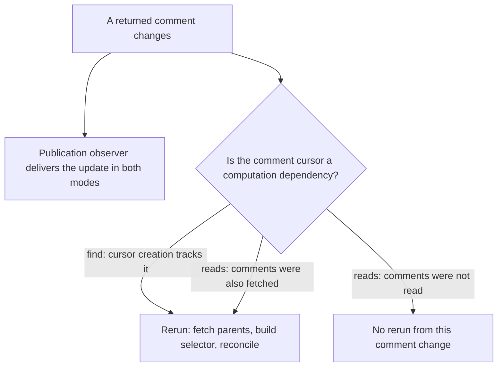

# Experimental cursor dependency modes

This guide describes the **unreleased prototype** on the local
`perf/reactivity-experiments` branch. It is separate from the PR #10 release
candidate and is not an option provided by the currently published package.
Existing behavior remains the default. There is no global switch.

Use `cursorDependencies: 'reads'` when changes to a returned Mongo cursor should
update clients without necessarily executing the publication function again.
The option preserves the way publications return cursors and use async code,
but deliberately changes when that code runs.

## Publication examples

```js
Meteor.publish('postsWithComments', function () {
  return this.autorun(
    async () => {
      const parents = Posts.find({ active: true });
      const rows = await parents.fetchAsync();
      return [
        parents,
        Comments.find({ postId: { $in: rows.map((row) => row._id) } }),
      ];
    },
    { cursorDependencies: 'reads' }
  );
});

Meteor.publishReactive(
  'activePosts',
  function () {
    return Posts.find({ active: true });
  },
  { cursorDependencies: 'reads' }
);
```

## Choose the dependency contract

| Option               | When a Mongo cursor establishes a computation dependency                           | Returned cursor sends live updates? |
| -------------------- | ---------------------------------------------------------------------------------- | ----------------------------------- |
| Omitted, or `'find'` | Creating the cursor establishes a dependency, even if the function never reads it. | Yes                                 |
| `'reads'`            | Supported reads establish the dependency; cursor creation alone does not.          | Yes                                 |

`cursorDependencies: 'find'` (or omitting the option) preserves the existing
contract: constructing a cursor establishes an autorun dependency. `reads` is an
explicitly different contract for Mongo-backed cursors: `fetchAsync`, `mapAsync`,
`forEachAsync`, `fetch`, and `countAsync` establish dependencies; cursor creation
alone does not. Returned cursors continue publishing live document changes.
Prefer the async read APIs in Meteor 3. This is not a promise that every cursor
or raw-driver method establishes a dependency. Raw aggregations do not acquire
one from this option. Existing reactive sources such as `ReactiveVarAsync`
retain their normal dependency behavior.

Local in-memory collections retain their existing cursor-creation dependencies,
including synchronous `fetch()`/`count()` behavior. The optimization is scoped to
Mongo-backed cursors; this fallback avoids making a local read nonreactive.

In the example, changing a returned comment updates the client without rerunning
the entire function. Changing the fetched parent result still reruns it and
selects the correct comment query. For that example, assuming no other dependency
changes:

| Change                                               | Default `'find'`                                           | Opt-in `'reads'`                                                                               |
| ---------------------------------------------------- | ---------------------------------------------------------- | ---------------------------------------------------------------------------------------------- |
| A visible comment's text changes                     | The comment updates on the client; the function can rerun. | The observer updates the comment on the client; this change alone does not rerun the function. |
| A post enters or leaves the active parent result     | The function reruns and recalculates the comment query.    | The function reruns because it reads the parents, and recalculates the comment query.          |
| A field in the fetched parent result changes         | The function can rerun.                                    | The function can rerun, even if the application only uses parent IDs afterward.                |
| The function also fetches comments to derive authors | Comment changes can rerun the function.                    | Comment changes can rerun the function because comments are now a read dependency.             |

These are dependency rules, not a promise of exactly one execution per database
write: a write can affect several observers or dependencies. Dependencies follow
the query and projection actually read; the engine does not infer which object
properties the rest of the function happens to use.

This option does not automatically narrow projections or add a database result
cache, and it does not intentionally coalesce intermediate notifications. Reads
still use the normal database cursor implementation.

## Behavioral limitations

Opt in only when the function does not rely on an unconsumed cursor to trigger
side effects or other derived work. Code that creates a cursor, then sends a
notification or computes unrelated state on every document change will observe
fewer executions in this mode. Getting the same final documents is not a promise
of identical execution behavior. A `countAsync` read remains reactive, including
insertions and removals.

The setting is per invocation of `this.autorun`, `Meteor.publishReactive`, or
`AsyncTracker.autorun`. Nested autoruns keep the default unless explicitly given
their own option. Other concurrent publications keep their own settings.
Unrecognized modes fail validation rather than silently selecting a behavior.
This is a server Mongo optimization, not a client Tracker mode. To restore the
default, omit the option or select `'find'` when creating a new computation.
The prototype has no supported live mode-switching API for existing computations.

## Why this can save substantial work

A returned cursor already has an observer that can deliver document changes to
the client. Under the default contract, creating that cursor also establishes a
dependency on the computation. A change can therefore cause both live delivery
and another execution of the whole publication function.

If that function fetches parents, rebuilds a combined child selector and
reconciles its returned cursors, the extra execution can be much more expensive
than delivering the changed child. Multiple subscribers amplify that cost.
Read mode omits the computation dependency for the cursor that is only returned,
while preserving its publication observer.



The expected benefit depends on how much work the avoided executions perform.
A simple cursor publication can avoid many cheap executions yet save only a
modest fraction of total CPU: Mongo observation, DDP delivery and client work
still exist. A deep join that reads each level must still recompute when those
inputs change. This option does not convert an arbitrary function into an
incremental join.

Cursor-object reuse already exists. This option does not turn shared queries
across subscribers into a shared database result cache. Actual reads still use
the normal cursor implementation. Fewer user-code executions are the explicit
behavioral change.

## Examples where the distinction matters

### Reactive counts outside a publication

```js
import { AsyncTracker } from 'meteor/nachocodoner:reactive-publish';

const counter = AsyncTracker.autorun(
  async () => {
    const count = await Posts.find({ active: true }).countAsync();
    console.log('Active posts:', count);
  },
  { cursorDependencies: 'reads' }
);

// When the owner no longer needs this computation:
// counter.stop();
```

The count remains reactive, including insertions and removals. This is not a
count-specific optimization: other changes observed by the query can still
invalidate it. Standalone computations have an owner responsible for stopping
them; publication autoruns retain their subscription lifecycle.

### Side effects depend on the current execution behavior

```js
Meteor.publishReactive(
  'postsWithExecutionTracking',
  function () {
    const cursor = Posts.find({ active: true });
    recordPublicationExecution(); // Application-specific side effect.
    return cursor;
  },
  { cursorDependencies: 'find' }
);
```

Changing this to `'reads'` means document changes alone no longer invoke
`recordPublicationExecution()`. The initial invocation still happens. Keep the
default if those later executions are intentional. Neither mode turns an autorun
into a guaranteed once-per-write audit mechanism.

### An unconsumed query deliberately declares a dependency

```js
Meteor.publishReactive(
  'totals',
  async function () {
    Posts.find({ active: true }); // Deliberate dependency under the default.
    const totals = await Posts.rawCollection()
      .aggregate([
        { $match: { active: true } },
        { $group: { _id: '$category', count: { $sum: 1 } } },
      ])
      .toArray();
    await this.setData('totals', totals);
    this.ready();
  },
  { cursorDependencies: 'find' }
);
```

Selecting `'reads'` here would remove the intended dependency: the `find()`
result is never read, and the raw aggregation does not replace it. Keep `'find'`
unless the computation explicitly establishes all necessary dependencies another
way. Adding a fetch solely to establish a dependency can itself add work; it is
not automatically a performance improvement.

## Choose a publication and evaluate it

| Publication pattern                                                       | Likely fit                                               | Reason                                                              |
| ------------------------------------------------------------------------- | -------------------------------------------------------- | ------------------------------------------------------------------- |
| Return a cursor; no logic needs to rerun for its changes                  | Good candidate                                           | The publication observer can handle live delivery.                  |
| Fetch parents, return children without reading them                       | Good candidate after reviewing side effects              | Child-only changes can avoid repeating parent-selection work.       |
| Fetch parents and children to compute another level                       | More limited benefit                                     | Those reads remain dependencies and still rerun the whole function. |
| Unconsumed `find()` declares a dependency for aggregation or derived work | Keep the default                                         | Cursor creation is part of the intended reactivity.                 |
| Local in-memory collections                                               | No benefit from this mode's cursor-creation optimization | Compatibility fallback preserves eager dependencies.                |

Start with one publication whose function selects data and has no required side
effects on changes to its unconsumed cursors. Check exact documents, field
clearing, relationship changes, ordering/windows, readiness and unsubscribe, as
well as execution-dependent behavior. Then compare the modes with the same
fixture and workload, using fresh runs in balanced order. Count reruns and reads
alongside CPU and latency to explain any benefit.

## Validation and local measurements

The prototype includes exact DDP-data checks, default-vs-opt-in rerun checks,
reactive counts, projected ordering/field removal across awaits, cache cleanup,
scope isolation, and removed-document membership cleanup without reruns.
This is not yet a general release recommendation: broader
core compatibility and application-specific side effects still need evaluation.

For local DDP experiments, the harness accepts `--cursor-dependencies find|reads`.
Raw results record the mode, and ordinary revision comparison refuses to mix
modes. The explicit `cursor-dependencies` comparison mode requires the same
reactive source on both sides. Library comparison permits this declared
implementation choice but rejects changing the mode within one set of repeats.
Invalid data and cleanup results remain excluded from performance comparisons.

Measured performance conclusions and raw data remain in Git-ignored
`bench/private/` and `bench/results/`; they are deliberately absent from this
usage guide. The package's `.meteorignore` excludes the benchmark tooling and
reports from Meteor publication.
